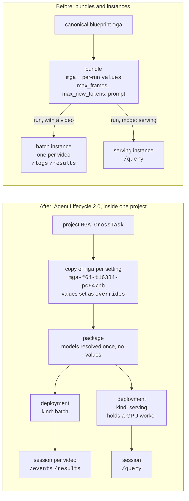

# Migrating to Agent Lifecycle 2.0

How this example moved from bundles and instances to **projects, packages,
deployments and sessions**, and what to watch for if you move your own scripts.

`/api/agents/bundles` and `/api/agents/instances` are being removed: some deployments of
the platform already answer 404 for them, and the rest keep them only until their next
platform release. A deployment serves the new calls when
`GET {root}/api/agents/sessions?limit=1` answers 200, not 404.

MGA fits nothing, so its move is simpler than the fitted agents' (AD, OSM, RED): no
optimization, no promotion. The one thing a bundle did that nothing downstream of a
blueprint can do any more is carry `values`, and for MGA that includes the
instruction itself. A **copy of `mga` with `overrides`** takes its place.

## Before and after

- **Project:** where everything lives. A copy of a blueprint lands in the project you
  name; its package, deployments and sessions take their project from it.
- **Copy:** `mga` with this setting's values set on it, under a key that names them:
  `mga-f<max_frames>-t<max_new_tokens>-p<prompt>`, the prompt as the first 6 hex of
  its md5. One per setting, reused by every later run at that setting, from any script.
- **Package:** one blueprint, target `platform`, with its models resolved when it is
  built. It has **no values**.
- **Deployment:** the package placed to run. `batch` is ready at once; `serving`
  places and loads the agent on a GPU worker and holds it until it is stopped.
- **Session:** a run on a deployment. On `batch`, one run over one video. On
  `serving`, a client's handle on the loaded agent, answering `/query` once it is
  `running`.

## What moved where

| Before | After | Why it changed |
|---|---|---|
| canonical `mga`, outside any project | a copy of `mga` in your project | a deployment needs a project, and everything takes its project from the blueprint it starts from |
| `values` on a bundle, the prompt among them | `overrides.values` on the copy, one copy per setting | a package, a deployment and a batch session take no values |
| bundle | package | its models are resolved once, at build time |
| instance (batch), one per video | batch deployment + a session per video | the deployment is set up once per setting; each video is a session |
| instance (serving) | serving deployment + a session | the deployment holds the loaded agent; the session is a client of it |
| `/logs`, to spot a stuck or empty run | session `status`, `error`, `/events`; count the steps | a session has no `/logs` |
| `GET /instances` to find runs after a disconnect | `state/lifecycle.json` | each session is recorded the moment it is opened |

## Old calls, new calls

All paths are under `{root}/api/agents` unless shown otherwise.

| Before | After |
|---|---|
| — | `POST {root}/api/projects` `{name, description}` |
| `POST /bundles` `{blueprint: "mga", values}` | `POST /blueprints/mga/copy` `{project_id, blueprint_key, overrides: {values}}`, then `POST /packages` `{blueprint_ids: [blp_…], target: {kind: "platform"}, name}`; poll until `ready` |
| `POST /bundles/{id}/run` `{connectors}` | `POST /deployments` `{package_id, kind: "batch"}`, then `POST /sessions` `{deployment_id, connectors: {source: [mp4]}}` |
| `POST /bundles/{id}/run` `{mode: "serving"}` | `POST /deployments` `{package_id, kind: "serving"}`; poll until `ready`; `POST /sessions` `{deployment_id}`; poll until `running` |
| `GET /instances/{id}` | `GET /sessions/{id}` (`status`, `error`) |
| `GET /instances/{id}/logs` | `GET /sessions/{id}/events` (newest first; there is no `/logs`) |
| `GET /instances/{id}/results` | `GET /sessions/{id}/results` |
| `POST /instances/{id}/query` | `POST /sessions/{id}/query` (same body, same `response`) |
| `POST /instances/{id}/cancel`, `DELETE /instances/{id}` | `POST /sessions/{id}/cancel`, `DELETE /sessions/{id}` |
| `DELETE /bundles/{id}` | `POST /deployments/{id}/stop`, `DELETE /deployments/{id}`, then `DELETE /packages/{id}` |

Statuses: package `building → ready | failed`; deployment `deploying → ready → stopping
→ stopped | failed`; session `pending → running → completed | failed | cancelled` (and
`paused`).

## What changed in practice

1. **Values go on a copy, one copy per setting.** A bundle took `max_frames`,
   `max_new_tokens` and `prompt` per run. A package, a deployment and a batch session
   take none; a batch session given `values` is refused with a `422`. A copy takes
   `overrides.values`, and since `mga` fits nothing, any of its values may be set
   there. `mga_project.py` keys each copy by its values (`mga-f64-t16384-pc647bb`),
   finds it in the project or makes it, and reuses its package and deployments, so
   any later run at that setting builds nothing new. A different `--max-frames`,
   `--max-new-tokens` or `--prompt` is a different copy. A lock in `state/` stops two
   scripts started at once from building two packages for one setting.

2. **A plain copy runs at the blueprint's defaults, and they are not this example's.**
   Dev's `mga` blueprint (2026-11) defaults to `max_new_tokens` 8192 and the prompt
   *"Generate a concise, ordered list of distinct steps with 10 steps or less."* —
   the ~10-step ceiling this example measured halving the manual, and a budget
   between the 4096 that returned an empty manual here and the 16384 that did not.
   So the copy always sets all three: `max_frames` 64, `max_new_tokens` 16384 and the
   example's own prompt (`DEFAULT_PROMPT` in `run_mga_example.py`).

3. **The instruction is a value, so it moved with them.** MGA takes no text input
   (`text_extensions: []`); its instruction is the blueprint's `prompt` value. With
   bundles it rode on each bundle; now it is set on the copy, and a new prompt is a
   new copy. Only the video moved to the session's `connectors.source`, unchanged.

4. **Serving queries still send the prompt as `query`.** A serving query's body is
   unchanged: `{"model": "mga", "query": "<prompt>", "file_ids": ["base64:<mp4>"]}`.
   `sweep_serve.py` still prepends its chunk preamble to every chunk after the first
   in `query`, and uses the same per-setting copy as batch for everything else.

5. **A copy checks keys; it does not check wiring.** A bundle stored any key and
   ignored the ones the blueprint did not use. A copy refuses a key the blueprint
   does not declare with a `400`, but still accepts a declared value that no node
   references. The preflight in `run_mga_example.py` still reads the blueprint
   document for that.

6. **A session has no `/logs`.** A bundle run's `/logs` carried model-load timings,
   the parser's warnings and errors; its `WARN` that generation *"ended inside the
   model's reasoning block"* was the only place an empty manual showed why. A session
   has lifecycle `/events` (opened, dispatched, failed with a reason) and a terminal
   `status` with `error`. An empty manual still ends `completed`, so
   `run_mga_example.py` counts the steps and warns on zero. Whether the token budget
   or a format-specifying prompt caused it can no longer be told apart from outside.

7. **A serving deployment holds the GPU, not the session.** `sweep_serve.py` cancels
   and deletes its session and stops and deletes the serving deployment on exit,
   Ctrl-C and `kill` included; `--keep` leaves both up for `--session`. A serving
   session closes after 30 idle minutes by default. The script no longer refuses a
   non-dev endpoint.

8. **A session's result `ref` is a root path.** `/sessions/{id}/results` returns
   `ref: "/api/files/<fil_…>/content"`, which already includes `/api`; appending it to
   an `…/api` endpoint gives `/api/api/…` and a 404 (`mga_api.fetch_ref`).

9. **Record ids before waiting on them.** A run is ~10 minutes and the client can die
   while it goes on. Every session is written to `state/lifecycle.json` the moment it
   is opened, and every package and deployment before anything waits on it, so
   `cleanup.py` finds them. With bundles, `GET /instances` listed the org's runs
   instead.

10. **Cleanup goes session, deployment, package.** Each holds the next. `cleanup.py`
    starts from each recorded package and lists its deployments and their sessions,
    so ones a script never recorded are found too. The project and its copies stay;
    delete the copies and then the project by hand if you want them gone.

## This repo, file by file

| File | Change |
|---|---|
| `mga_api.py` | `get_blueprint`, `copy_blueprint`, `create_package` and `package_ready`, `deploy` and `deployment_ready`, `open_session`, `wait_running`, `poll_session` (status and `/events`), `fetch_results` from sessions with root-path refs, `cancel_session`, `end_session`, `end_deployment`; `poll_agent`, `jos_job_id` and `download_results` removed |
| `mga_project.py` | new: the project `MGA CrossTask`, a copy of `mga` per setting, its package and deployments, and every session, in `state/lifecycle.json` |
| `run_mga_example.py` | one batch session on the setting's deployment, through `mga_api.py` instead of its own HTTP code; `--dry-run` prints the copy, package, deployment and session bodies; `--name` removed |
| `sweep_serve.py` | a serving deployment and one session, both deleted on exit; `--agent` becomes `--session`; `--blueprint` added; the dev-only check removed |
| `cleanup.py` | new: sessions, deployments, packages, found from each recorded package |
| `inspect_bundle.py`, `probe_max_frames.py`, `poll_probe.py`, `watch_runs.py` | removed: bundle and instance diagnostics, with nothing to call any more |
| `repro_truncation.py` | unchanged: `--analyse` reads committed outputs offline; its live mode still creates bundles and will not run where they are gone |
| `.gitignore` | `state/` |

## Results

The results in the README were measured with bundles. On this branch, on a deployment
that serves the new calls (2026-11-05), `python3 run_mga_example.py` on the tire clip
gave the README's prod manual exactly: 16 steps over 14–138 s, content md5
`866909a9315bce0e493db7ab1627749d` (the same as
`reference/mga-output-i2JWkDyg26A-20261027-PROD-16steps.json`), so `evaluate.py`
scores it the same: 11/11 reference steps at IoU ≥ 0.3, 7/11 at IoU ≥ 0.5, mean IoU
0.56. The session took 10.6 minutes from opening to `run completed`. Serving has not
been rerun on the new lifecycle yet.

## Moving your own scripts

1. Create a project, or reuse yours, and copy the blueprint you start from into it,
   with the values your runs need as `overrides.values` — for MGA, the prompt too.
   Make one copy per setting.
2. Package the copy (poll until `ready`), deploy the package as `batch` or
   `serving`, and replace each run with a session on that deployment.
3. Move each run's video to the session's `connectors.source`, unchanged. Serving
   queries keep their body, prompt in `query` included.
4. Poll the session's `status`, read `/events` and `/results`, and resolve result
   refs against the root, not against `…/api`. Count the steps in each manual
   yourself: there is no `/logs`.
5. Clean up sessions, then deployments, then packages; stop serving deployments
   when you're done, since each holds a worker.
