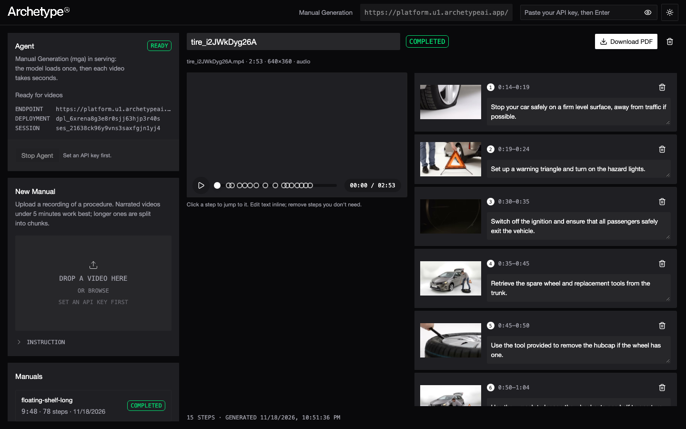
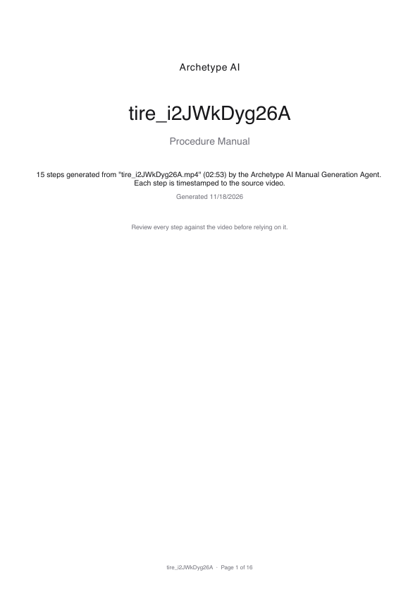
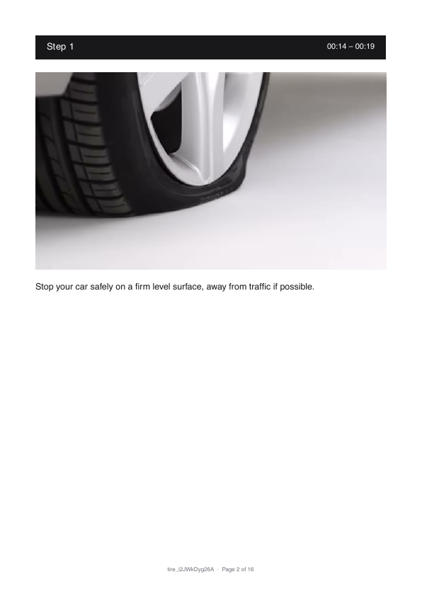

# Manual Generation App

Upload a procedure video and get back an ordered, timestamped manual: one step per
action, a frame for each step, editable in the browser and exported as a PDF. It runs
Archetype AI's **Manual Generation agent** (`mga`) **in serving** on Agent Lifecycle
2.0, so the model loads once and every later video takes seconds.

Built with the [Archetype AI design system](https://github.com/archetypeai/agent-skills/tree/main/skills/atai-design-system)
(scaffolded with `npx @archetypeai/ds-cli@latest create`), following
[manual-gen-with-manual-generation-agent](https://github.com/archetypeai/manual-gen-with-manual-generation-agent).



```
video ─► probe ─► fit under 2 MiB ─► serving session /query ─► merge ─► frames ─► edit ─► PDF
        (ffprobe) (re-encode, or 90 s                (chunks only)  (ffmpeg)
                   chunks past 5 min)
```

## Run it

Needs Node 22+ and `ffmpeg`/`ffprobe` on the PATH (`brew install ffmpeg`).

```sh
cd app
npm install
cp .env.example .env      # optional: MGA_API_ENDPOINT (defaults to production), MGA_API_KEY
npm run dev               # or: npm run build && npm start
```

1. **Set your API key**, either way:
   - **In the app:** paste it in the top bar and press Enter. It is held in page state
     only and sent with each request, never written to disk, so you paste it again
     after a reload.
   - **In `.env`:** set `MGA_API_KEY`. The server uses it whenever no key is pasted,
     and never sends it to the browser.

   A pasted key takes precedence; clear the field to go back to the `.env` key. Either
   way it is checked against the `mga` blueprint first. The app reads `MGA_*` rather
   than `ATAI_*` so a key or endpoint exported in your shell for other tools is not
   picked up by accident.

   The endpoint comes from `MGA_API_ENDPOINT` (production if unset). To use another
   one, type it in the endpoint field next to the key and press Enter: it is kept only
   if your key works there, held until the server restarts, and locked while the agent
   is up, since a deployment belongs to one endpoint.

2. **Start agent**, or just drop a video: the agent starts on demand. The first start
   takes about 15 minutes while the model loads on a GPU.
3. Drop a video. Steps come back with timestamps and frames; click one to play it,
   edit the text, remove steps you don't need, **Save changes**, then **Download PDF**.
   **Check before downloading** lists what to verify (made-up step times, parts of the
   video with no steps, possible duplicates); click a time range to play it. A failed
   run has **Retry**, which reuses the uploaded video. `/?run=<id>` opens one manual.
4. **Stop agent** when you're done. A serving deployment holds a GPU worker until
   it is stopped; the platform closes an idle session after 30 minutes, and the app
   reopens one on the same deployment at the next video.

The PDF has a title page, then one step per page with its frame and time range:

<p>
  
  
</p>

## How serving is set up

`src/lib/server/serving.ts` finds or makes, and records in `data/serving-<host>.json`
(one file per endpoint):

|               | Call                               | Notes                                                                                     |
| ------------- | ---------------------------------- | ----------------------------------------------------------------------------------------- |
| project       | `POST /projects`                   | `Manual Generation App`, found by name later                                              |
| copy of `mga` | `POST /agents/blueprints/mga/copy` | key `mga-f64-t16384-pc647bb`: `max_frames` 64, `max_new_tokens` 16384, the default prompt |
| package       | `POST /agents/packages`            | polled until `ready`                                                                      |
| deployment    | `POST /agents/deployments`         | `kind: serving`, polled until `ready`                                                     |
| session       | `POST /agents/sessions`            | polled until `running` (the model load)                                                   |
| per video     | `POST /agents/sessions/{id}/query` | `{"model": "mga", "query": <prompt>, "file_ids": ["base64:<mp4>"]}`                       |

Before starting, it checks that `mga` actually uses each value it sets, because a value
it doesn't use is accepted and silently ignored.

## What the app handles for you

- **The 2 MiB request cap.** A video goes inline as base64, so it is re-encoded
  (smaller frames, lower rate, mono 16 kHz audio) until it fits. MGA samples 64 frames
  at 224 px anyway; the soundtrack is kept because step boundaries come from speech.
- **Long videos.** Past 5 minutes, or when the whole video can't fit, the video is cut
  into 90 s chunks with 15 s overlap. Every chunk after the first is told it is a
  segment. Answers are moved to video time and overlap duplicates are removed (the
  rule from `merge_chunks.py`; two steps up to 3 s apart also count when they share
  60%+ of their words). A chunk that comes back repeating itself, without timestamps,
  or (with audio) with evenly spaced made-up times is sent again once as two shorter
  overlapping halves, since the same input gets the same answer. Whatever is still
  unusable is dropped or flagged with its time range.
  The limit is 60 chunks, so the maximum length is about 75 minutes; longer videos are
  refused at upload.
- **Made-up times.** A part whose steps are 75%+ one length (a grid, not a reading of
  the video) is flagged, and so are overlapping steps from different chunks that share
  25–35% of their words (possible duplicates).
- **Silent videos** are flagged: without narration, step times fall on an even grid.
- **Platform hiccups.** A deployment that fails for lack of GPU capacity is redeployed
  with a growing wait, for up to 45 minutes. A lost response to the create call is
  recovered by adopting the live deployment of the package instead of making a second
  one. **Stop agent** ends every session on the deployment, then the deployment.
- **Empty manuals** fail the run instead of showing a blank result.

## The instruction

Open **Instruction** under the drop zone to change what the manual covers for one
video. Say what to **cover**, never how to **format**: the agent's parser owns the
output layout, and a prompt that asks for headings or bullets returns zero steps.

## Files

```
src/lib/server/   config · key · atai (API client) · serving · video (ffmpeg) · merge · pipeline · store · pdf
src/lib/api/      browser calls
src/lib/components/ui/custom/   AgentPanel · NewManual · RunList · ManualView · ApiKeyField
src/routes/api/   config (endpoint) · serving · runs · runs/[id] (edit, retry, delete) · pdf · video (Range) · frames
screenshots/      README images
data/             uploads, frames, runs.json, serving-<host>.json (gitignored)
CLAUDE.md, ds-manifest.json   the design system's own agent config (from ds-cli)
```

## Notes

- Runs are processed one at a time and survive a page reload; a run in progress when
  the server restarts is marked failed (use **Retry**). Don't edit server code while a
  run is in progress under `npm run dev`: the reload can leave the old and new code both
  talking to the platform.
- Brand fonts (PP Neue Montreal) are licensed and not included, so the UI uses system
  fonts. Put the font files in `static/fonts/` to enable them, and keep them out of
  any public repo.
- `vite.config.ts` aliases `tw-animate-css` to its CSS file: `@tailwindcss/vite` 4.3
  can't resolve that package's `style`-only export in Vite 8's SSR build.
